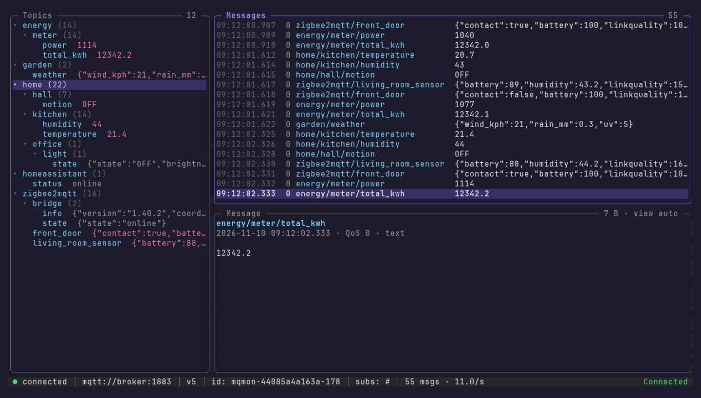
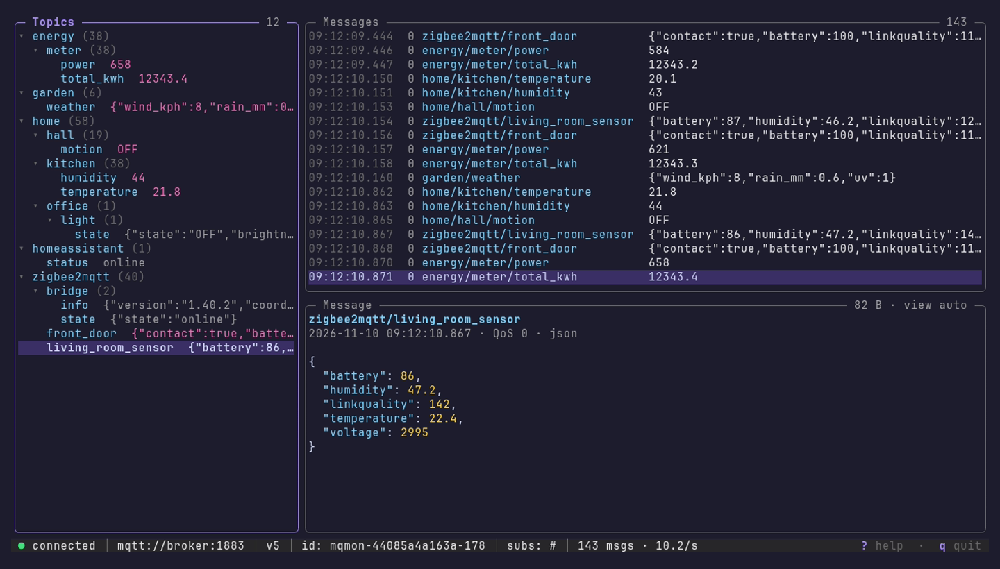
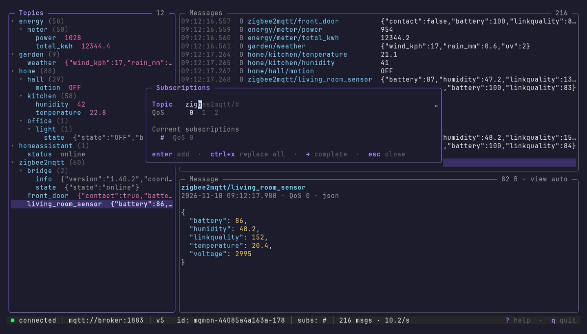
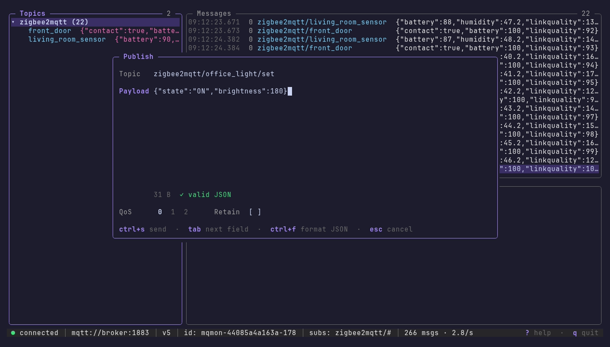

# MQTT Monitor

[](https://pkg.go.dev/github.com/paul-ridgway/mqtt-monitor)

A terminal client for MQTT brokers: watch messages arrive, browse a live topic tree, change subscriptions on the fly and publish, all from one full-screen view.


| | |
| --- | --- |
|  |  |
| **Live view**: topic tree with latest values, message list, detail pane and status bar | **Topic tree**: browse the hierarchy, pretty-printed JSON for the selected topic |
|  |  |
| **Subscriptions**: add, replace or remove topics mid-run, with completion from topics seen | **Publish**: topic completion, multi-line payloads, JSON check, QoS and retain |

## Running

Install with [Go](https://go.dev/dl/):

```
go install github.com/paul-ridgway/mqtt-monitor/cmd/mqmon@latest
```

and run `mqmon`. The long name is also available with `go install github.com/paul-ridgway/mqtt-monitor@latest` (runs as `mqtt-monitor`). Alternatively, download a prebuilt binary from the [releases page](https://github.com/paul-ridgway/mqtt-monitor/releases).

To always run the latest release without installing, use a wrapper script such as:

```bash
#!/bin/bash
exec go run github.com/paul-ridgway/mqtt-monitor/cmd/mqmon@latest "$@"
```

## Usage

```
mqmon                                   # pick a saved connection, or set up a new one
mqmon broker.local                      # connect to broker.local:1883, subscribe to #
mqmon home                              # use the saved profile called "home"
mqmon broker.local -t 'home/#' -t 'zigbee2mqtt/+'
mqmon mqtts://broker.example.com -u paul           # asks for the password
mqmon broker.local -V 5 -i my-client-id
mqmon broker.local --cafile ca.pem --cert me.pem --key me.key --tls
mqmon broker.local -t 'sensors/#' | grep temp      # plain "topic payload" lines when piped
mqmon broker.local --log messages.jsonl            # also record every message
```

When no broker is given, mqmon lists your saved connections (most recent first) or asks for a broker, username, MQTT version, topics and optionally a client ID and TLS files. When a username is given without a password it asks for one (it can also come from `$MQMON_PASSWORD`).

### Options

```
Connection:
  -h, --host <host>          Broker host, host:port or URL (mqtt://, mqtts://, ws://, wss://)
  -p, --port <port>          Broker port (default 1883, 8883 with TLS)
  -u, --username <user>      Username
  -P, --password <pass>      Password (or $MQMON_PASSWORD)
  -i, --client-id <id>       Client ID (default mqmon-<hostname>-<pid>)
  -V, --mqtt-version <3|5>   MQTT protocol version (default 3, i.e. 3.1.1)
  -k, --keepalive <secs>     Keep-alive interval (default 30)
      --tls                  Use TLS even if the URL does not say so
      --cafile <file>        CA certificate(s) to trust (PEM)
      --cert <file>          Client certificate (PEM)
      --key <file>           Client private key (PEM)
      --insecure             Do not verify the server certificate

Subscriptions:
  -t, --topic <filter>       Topic to subscribe to; repeat for more
  -q, --qos <0|1|2>          QoS for -t subscriptions (default 0)

Profiles:
  -c, --profile <name>       Use a saved profile
      --save <name>          Save this connection under a name (default: the host)
      --save-password        Store the password in the profile
      --no-save              Do not record this connection
      --list                 List saved profiles
      --forget <name>        Delete a saved profile

Output:
      --plain                Print "topic payload" lines instead of the interface
      --timestamps           With --plain, prefix each line with the time
      --log <file>           Append every message to a JSON lines file
      --buffer <n>           Messages kept in memory (default 10000)
```

### Keys

| Key | |
| --- | --- |
| `tab` / `shift+tab` | Move between the topic tree, message list and detail pane |
| `s` | Subscriptions: add one (`enter`), replace all with one (`ctrl+x`), remove (`x`) |
| `p` | Publish, with the topic of the current message filled in |
| `P` | Edit and re-publish the current message |
| `D` | Delete the retained message on the current topic |
| `/` | Filter: plain text matches topic or payload, `+`/`#` filters match topics |
| `f` | Filter to the current topic or branch (again to clear); `esc` clears |
| `space` | Pause / resume the message list (messages are still received) |
| `v` | Payload view: auto (pretty JSON, hex for binary), raw, hex |
| `y` / `Y` | Copy the payload / topic |
| `c` | Clear messages and topics |
| `t` | Show / hide the topic tree |
| `?` | Help |
| `q`, `ctrl+c` | Quit |

In the topic tree `→`/`←` expand and collapse, `enter` filters to a topic or branch and `e`/`E` expand or collapse everything. In the message list `g`/`G` jump to the first or latest message; the list follows new messages while the latest is selected. In the publish dialog `ctrl+s` sends, `↑`/`↓` on the topic field step through recent publishes and `ctrl+f` formats a JSON payload. Topic fields complete from the topics seen so far with `→` or `tab`. The mouse wheel scrolls and clicking selects.

## Profiles

Every connection is remembered in `~/.config/mqtt-monitor/config.json` (or `$MQMON_CONFIG`), keyed by name (the host by default, or `--save <name>`), along with its last subscriptions and recent publishes, so `mqmon <name>` picks up where you left off. Command line options override the saved settings. Passwords are only stored when you pass `--save-password`; the file is readable only by you.

## Development

```
./scripts/build.sh         # build into ./bin, then run ./bin/mqmon
./scripts/test-run.sh      # build and run against a throwaway Mosquitto broker in Docker
./scripts/record-demo.sh   # re-record demo.gif and docs/*.png with VHS (Docker)
go run ./cmd/mqmon         # run from source
go test ./...              # run the tests
./scripts/local-install.sh
```

## Releasing

The tool is published as a Go module, so a version is published by creating a GitHub release from `main` with a new `vX.Y.Z` tag (the `v` prefix is required). Either create it on the [releases page](https://github.com/paul-ridgway/mqtt-monitor/releases/new), or run:

```
./scripts/release.sh v1.2.3
```

which runs the tests, pushes `main` and creates the release with generated notes.

The Release workflow then attaches prebuilt binaries to the release and asks the Go module proxy to index the version, after which `go install ...@latest` and [pkg.go.dev](https://pkg.go.dev/github.com/paul-ridgway/mqtt-monitor) pick it up.
